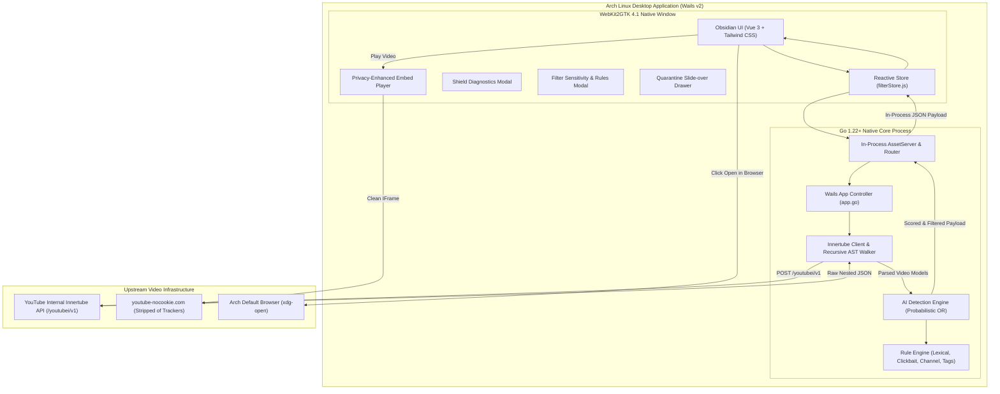

# 🛡️ AI-Free YouTube (`aifreeyoutube`)

> **YouTube without the AI slop. An authentic, human-first video portal.**

**AI-Free YouTube** restores the original spirit of independent, human video creation. Built with **Go** and **Vue 3**, it transparently proxies YouTube feeds through an explainable multi-signal heuristic engine to detect and quarantine synthetic voiceover channels, ChatGPT-generated scripts, and algorithmic clickbait formulas.

Run it as a native Linux desktop application (via Wails v2 + WebKit2GTK), a local background daemon with YouTube Premium ad-free browser integration at `http://localhost:8484`, or cross-platform packages across Arch Linux, Debian/Ubuntu, Red Hat/Fedora, Windows, and macOS.

---

## Table of Contents

- [Vision & Motivation](#vision--motivation)
- [Key Features](#key-features)
- [System Architecture](#system-architecture)
- [Desktop Integration](#desktop-integration)
- [AI Detection Engine Deep Dive](#ai-detection-engine-deep-dive)
  - [Detection Signal Categories](#detection-signal-categories)
  - [Mathematical Scoring Model](#mathematical-scoring-model)
  - [Sensitivity Presets](#sensitivity-presets)
- [API Reference](#api-reference)
- [Project Directory Structure](#project-directory-structure)
- [Getting Started](#getting-started)
  - [Prerequisites](#prerequisites)
  - [Desktop App: Quick Start & Installation](#desktop-app-quick-start--installation)
  - [Official Arch Linux Package (PKGBUILD)](#official-arch-linux-package-pkgbuild)
  - [Standalone Web Server Mode](#standalone-web-server-mode)
  - [Frontend Hot-Reload Development](#frontend-hot-reload-development)
- [Universal Cross-Platform Packaging & Systemd](#universal-cross-platform-packaging--systemd)
- [Privacy & Playback Modes (YouTube Premium)](#privacy--playback-modes-youtube-premium)
- [License](#license)

---

## Vision & Motivation

The contemporary video streaming ecosystem is increasingly overwhelmed by low-effort, mass-produced **"AI slop"**:
- Automated text-to-speech voiceovers reading scraped Wikipedia or Reddit threads.
- Sensationalist clickbait thumbnails generated with Midjourney and DALL-E.
- Scripting formulas saturated with unmistakable LLM vocabulary (*"delve into"*, *"tapestry of"*, *"game-changer"*).
- Fake science, catastrophic clickbait, and fabricated history generated by bots to game the recommendation algorithm.

**AI-Free YouTube** restores the original spirit of independent human video sharing. It functions as both a **native desktop application** and a **standalone web server**: scraping clean search feeds via YouTube's internal Innertube engine, inspecting video metadata through an explainable multi-signal heuristic detector, quarantining suspected AI content, and streaming videos through privacy-hardened or YouTube Premium embed players.

---

## Key Features

1. **Native Desktop Experience (Wails v2 + WebKit2GTK)**:
   - Compiled natively against modern `webkit2gtk-4.1` and `gtk3`.
   - Native Linux desktop integration (`.desktop` launcher, high-res scalable SVG/PNG icons, Freedesktop compliant).
   - Fast startup, low memory footprint, and hardware-accelerated video rendering.
   - Built-in "Open in Browser" button leveraging `xdg-open` to watch videos in your favorite web browser.

2. **YouTube Premium Ad-Free & Privacy Playback Modes**:
   - **YouTube Premium Mode**: When browsing at `http://localhost:8484` in your browser (e.g., Vivaldi, Firefox, Chrome), player uses `youtube.com/embed` to inherit your active Google session cookies—delivering 100% ad-free playback for Premium subscribers.
   - **Privacy Mode**: Uses `youtube-nocookie.com` stripped of third-party tracking beacons and telemetry.

3. **Zero API Key Quota Dependency**:
   - Communicates directly with YouTube's desktop Innertube internal API (`/youtubei/v1/search`, `/youtubei/v1/next`).
   - Requires no Google Cloud project, no API keys, no billing, and suffers zero daily quota limits.

4. **Multi-Signal Heuristic & Probabilistic AI Detector**:
   - Evaluates titles, descriptions, channel handles, and tags across 7 rule categories.
   - Employs independent probability aggregation ($1 - \prod(1 - w_i \cdot c_i)$) to prevent false positives while catching compounding slop signals.

5. **100% Explainable AI Shield**:
   - Every video receives a **Human Authenticity Badge** (`98% Human`, `82% Human`, or `QUARANTINED`).
   - Users can click any shield badge to view exact triggered rules, confidence ratings, and matched substrings in real time.

6. **Interactive Quarantine Drawer**:
   - Blocked videos are not silently deleted; they are placed into a slide-over Quarantine Drawer.
   - Users can audit quarantined videos, view the detection rationale, and restore or whitelist creators with one click.

7. **Universal Packaging & Systemd Support**:
   - Packaged for Arch Linux (`PKGBUILD`), Debian/Ubuntu (`.deb`), Red Hat/Fedora (`.rpm`), AppImage, Flatpak, Snap, Windows (ZIP & Chocolatey), and macOS (tarball & Homebrew).
   - Bundled systemd user (`systemctl --user start aifreeyoutube`) and system daemon units.

8. **Customizable Filter Controls**:
   - Real-time sensitivity threshold adjustment (Aggressive 35%, Balanced 55%, Mild 75%).
   - Toggles for Lexical Markers, Clickbait Formulas, Bot Handles, Channel Blocklists, and Shorts Elimination.
   - Custom user blocklists and whitelists that persist across sessions.

---

## System Architecture



---

## Desktop Integration

AI-Free YouTube is fully configured for desktop environments (Arch Linux, Debian/Ubuntu, Fedora, etc.):

- **Desktop Entry**: [`build/linux/aifreeyoutube.desktop`](file:///home/christopher/Projects/aifreeyoutube/build/linux/aifreeyoutube.desktop) adheres to Freedesktop specifications with categories `AudioVideo;Video;Network;Player;` so it appears in application menus (Rofi, Wofi, KDE Application Launcher, GNOME Dash, Hyprland, Sway, etc.).
- **Vector & Raster Icons**: Scalable SVG icon at `build/appicon.svg` and 512x512 PNG icon at `build/appicon.png`.
- **Packaging Recipe**: [`PKGBUILD`](file:///home/christopher/Projects/aifreeyoutube/PKGBUILD) allows instant building and installation as an official Arch Linux package via `makepkg -si`.
- **System Browser Integration**: Direct bridge via `runtime.BrowserOpenURL` and `xdg-open` to open any video in your default browser.

---

## AI Detection Engine Deep Dive

### Detection Signal Categories

The AI Detection Engine (`internal/filter/`) evaluates candidate videos against seven specialized heuristic vectors:

| Signal ID | Category | Description & Example Patterns | Default Weight |
|---|---|---|:---:|
| `LLM_LEXICAL_MARKER` | LLM Phrasing | Unmistakable GPT style vocabulary: *"delve into"*, *"testament to"*, *"rich tapestry"*, *"game-changing"*, *"in conclusion"*, *"it's important to remember"*. | `0.70` |
| `LEAKED_PROMPT_SLOP` | Leaked Prompts | System prompt echoes: *"as an AI language model"*, *"certainly! here is a video script"*, *"regenerate response"*. | `0.98` |
| `CLICKBAIT_FORMULA` | Sensational Formulas | Bot clickbait templates: *"Scientists Are Terrified"*, *"James Webb Just Detected Something That Terrifies"*, *"Why Nobody Talks About"*. | `0.75` |
| `PASSIVE_INCOME_SLOP` | Get-Rich Schemes | Faceless automated money mills: *"Make $10,000/month with ChatGPT"*, *"Automated faceless YouTube channel in 2024"*. | `0.85` |
| `SYNTHETIC_MEDIA_TAG` | AI Disclosures | Explicit tags and descriptions indicating generative tools: `#midjourney`, `#elevenlabs`, `#sunoai`, `#genai`, `#stablediffusion`. | `0.85` |
| `KNOWN_AI_MILL` | Channel Blocklist | High-frequency automated content farms and spam channels matching known handle patterns (e.g. `tech-facts-daily-482`, `ai-wealth-matrix`). | `0.95` |
| `BOT_HANDLE_ANOMALY` | Suspicious Handles | Algorithmic usernames with excessive random digit suffixes or generic keyword stuffing (e.g. `@dailyquantumfacts94821`). | `0.55` |
| `SHORTS_SUPPRESSION` | Format Suppression | Eliminates vertical algorithmic shorts (under 60s) to prioritize long-form, thoughtful content. | `1.00` |

### Mathematical Scoring Model

Instead of a naive additive sum (which causes false-positive overflow) or simple threshold matching (which misses compounding subtle hints), the engine uses an **independent probability union formula**:

$$P(\text{AI}) = 1 - \prod_{i=1}^{k} \left(1 - w_i \cdot c_i\right)$$

Where:
- $w_i \in [0.0, 1.0]$ represents the baseline weight of rule $i$.
- $c_i \in [0.0, 1.0]$ represents the confidence of the match (e.g., regex pattern certainty, repetition count).
- $P(\text{AI})$ is the aggregate probability that the video is AI-generated.

The human authenticity score is the direct complement:

$$\text{HumanScore} = \text{round}\left((1 - P(\text{AI})) \times 100\right)$$

If $P(\text{AI}) \ge \text{Threshold}$, the video is quarantined with verdict `IsAIGenerated = true`.

### Sensitivity Presets

Users can adjust filtering aggressiveness on the fly via the UI or API:

- **Aggressive (Threshold: 35%)**: Maximum protection. Catches subtle AI-assisted scripts and borderline clickbait. Recommended for users seeking strictly human handcrafted videos.
- **Balanced (Threshold: 55%)**: *Default setting*. Eliminates all blatant AI voiceover mills, ChatGPT scripts, and faceless cash-cow channels with minimal human false positives.
- **Mild (Threshold: 75%)**: Lenient filtering. Flags only blatant, incontrovertible AI farms and leaked prompt scripts.

---

## API Reference

The Go core exposes clean REST endpoints (served in-process in Wails desktop mode and over HTTP in standalone server mode):

### 1. `GET /api/trending`
Returns an authentic, curated feed of popular human videos.

### 2. `GET /api/search?q={query}`
Searches Innertube for the given query and executes AI detection across all matches.

### 3. `GET /api/video?id={videoId}`
Fetches primary metadata for a specific video and returns filtered related recommendations.

### 4. `GET /api/filter/settings` & `POST /api/filter/settings`
Retrieves or updates filter sensitivity and individual rule category toggles in real time.

### 5. `GET /api/filter/stats`
Returns global lifetime metrics since boot (`totalScanned`, `totalBlocked`, `totalPassed`, `quarantineRate`).

### 6. `POST /api/filter/block-channel` & `POST /api/filter/whitelist-channel`
Dynamically adds channel handles or names to the session blocklist or whitelist.

---

## Project Directory Structure

```
aifreeyoutube/
├── Makefile                          # Unified desktop build, install, server, and test automation
├── PKGBUILD                          # Arch Linux package build recipe (makepkg/pacman)
├── README.md                         # Comprehensive architecture and user manual
├── wails.json                        # Wails v2 desktop configuration
├── main.go                           # Desktop application entrypoint (Wails + WebKit2GTK)
├── app.go                            # Desktop App controller with IPC bindings & in-process routing
├── go.mod                            # Unified Go module definition
├── build/                            # Desktop packaging assets
│   ├── appicon.svg                   # Scalable vector application icon
│   ├── appicon.png                   # 512x512 high-resolution icon
│   ├── bin/
│   │   └── aifreeyoutube             # Native compiled Arch Linux desktop executable
│   └── linux/
│       └── aifreeyoutube.desktop     # Freedesktop application menu launcher entry
├── cmd/
│   └── server/
│       └── main.go                   # Standalone HTTP web server entrypoint
├── internal/
│   ├── api/
│   │   ├── handlers.go               # REST controllers for search, video, settings, stats
│   │   ├── handlers_test.go          # Unit tests for HTTP endpoints
│   │   ├── middleware.go             # CORS headers and execution latency logger
│   │   └── router.go                 # URL multiplexer & embedded SPA static file server
│   ├── filter/
│   │   ├── blocklist.go              # Known AI farm handles, patterns, custom blocklist
│   │   ├── config.go                 # Thread-safe filter settings and sensitivity presets
│   │   ├── detector.go               # Probabilistic scoring engine & lifetime stats
│   │   ├── detector_test.go          # Comprehensive detector unit tests
│   │   ├── rules_channel.go          # Channel name & bot handle anomaly heuristics
│   │   └── rules_text.go             # LLM phrasing, clickbait formulas, tag regex rules
│   ├── models/
│   │   └── video.go                  # Core data structs (Video, FilterVerdict, etc.)
│   └── youtube/
│       ├── client.go                 # Innertube high-level service (Search, VideoDetails)
│       ├── innertube.go              # Low-level HTTP transport targeting Innertube API
│       ├── parser.go                 # Recursive AST-like JSON walker & lockupViewModel parser
│       └── parser_test.go            # Unit tests verifying extraction from raw YouTube responses
└── frontend/                         # Vue 3 Single Page Application
    ├── index.html                    # HTML entry point with dark theme and SEO metadata
    ├── package.json                  # NPM dependencies (Vue 3, Vue Router, Lucide Icons)
    ├── vite.config.js                # Vite build configuration & API reverse proxy
    ├── wailsjs/                      # Auto-generated Wails JavaScript bindings
    └── src/
        ├── App.vue                   # Root application shell
        ├── main.js                   # Application bootstrap
        ├── router.js                 # Vue Router configuration
        ├── style.css                 # Dark obsidian design tokens and animations
        ├── components/
        │   ├── FilterSettingsModal.vue # Interactive sensitivity slider & rule toggles
        │   ├── FilterShieldModal.vue   # Real-time explainability & signal inspector
        │   ├── Navbar.vue              # Global navigation, search input, Shield status
        │   ├── QuarantineDrawer.vue    # Slide-over blocked video viewer with 1-click restore
        │   ├── VideoCard.vue           # Video card with Human Authenticity Pill
        │   ├── VideoGrid.vue           # Responsive grid with loading skeletons & empty states
        │   └── VideoPlayer.vue         # Privacy-enhanced nocookie embed container
        ├── stores/
        │   └── filterStore.js        # Reactive state store for filter settings & metrics
        └── views/
            ├── HomeView.vue          # Curated authentic trending home feed
            ├── SearchView.vue        # Search results view with live quarantine metrics
            └── WatchView.vue         # Video playback view with filtered recommendations
```

---

## Getting Started

### Prerequisites

All standard Linux (Arch, Fedora, Debian/Ubuntu) dependencies:
```bash
sudo pacman -S webkit2gtk-4.1 gtk3 glib2 go npm
```

### Desktop App: Quick Start & Installation

You can build, test, and install the desktop app with one command:

```bash
cd /home/christopher/Projects/aifreeyoutube

# 1. Build the native Arch desktop application
make desktop

# 2. Install to ~/.local (installs binary, desktop launcher, and icons)
make install-desktop
```

Once installed, **AI-Free YouTube** is available in your application launcher (Rofi, Wofi, KDE Kickoff, GNOME Dash, etc.) and can be launched directly from any terminal:
```bash
aifreeyoutube
```

To run directly from the source directory without installing:
```bash
make run
```

To uninstall from `~/.local`:
```bash
make uninstall-desktop
```

### Official Arch Linux Package (PKGBUILD)

To create an Arch Linux `.pkg.tar.zst` package installable via `pacman`:

```bash
cd /home/christopher/Projects/aifreeyoutube
makepkg -si
```

### Standalone Web Server Mode

If you prefer running AI-Free YouTube as a headless or local web server on port 8484:

```bash
# Compile and start the server
make run-server
```
Visit **`http://localhost:8484`** in any browser.

### Frontend Hot-Reload Development

For live Vite Hot Module Replacement (HMR) during frontend editing:
```bash
cd frontend
npm run dev
```

### Running the Test Suite

```bash
make test
```

---

## Universal Cross-Platform Packaging & Systemd

AI-Free YouTube supports automated packaging for all major desktop platforms and Linux package formats.

### 1. Systemd Service Integration
- **User Service (Recommended for desktop users)**:
  ```bash
  make service-start     # Enables and starts service for your desktop user
  make service-status    # Inspect live status
  make service-stop      # Stop background service
  ```
  *Accessible at `http://localhost:8484` continuously, auto-starting on login.*
- **Hardened System-wide Service**:
  ```bash
  make systemd-install   # Installs to /etc/systemd/system/aifreeyoutube.service
  ```

### 2. Linux Distribution Packages
- **Debian / Ubuntu (`.deb`)**:
  ```bash
  make deb
  # Generated in build/dist/aifreeyoutube_1.0.0_amd64.deb
  sudo dpkg -i build/dist/aifreeyoutube_1.0.0_amd64.deb
  ```
- **Red Hat / Fedora / openSUSE (`.rpm`)**:
  ```bash
  make rpm
  # Generated in build/dist/aifreeyoutube-1.0.0-1.x86_64.rpm
  ```
- **Linux Universal AppImage**:
  ```bash
  make appimage
  # Standalone single-file executable: build/dist/aifreeyoutube-1.0.0-x86_64.AppImage
  ./build/dist/aifreeyoutube-1.0.0-x86_64.AppImage
  ```
- **Flatpak**:
  ```bash
  make flatpak
  # Manifest at packaging/flatpak/com.aifreeyoutube.app.yml
  flatpak-builder --user --install --force-clean build/flatpak-build packaging/flatpak/com.aifreeyoutube.app.yml
  ```
- **Canonical Snap**:
  ```bash
  make snap
  # Recipe at packaging/snap/snapcraft.yaml
  ```

### 3. Windows (Executables, ZIP & Chocolatey)
- **Windows 64-bit Bundle**:
  ```bash
  make windows
  # Generates build/dist/aifreeyoutube-v1.0.0-windows-amd64.zip containing aifreeyoutube-server.exe & batch launcher
  ```
- **Chocolatey Package**:
  - Manifest: [`packaging/windows/chocolatey/aifreeyoutube.nuspec`](file:///home/christopher/Projects/aifreeyoutube/packaging/windows/chocolatey/aifreeyoutube.nuspec)
  - Install Script: [`packaging/windows/chocolatey/tools/chocolateyinstall.ps1`](file:///home/christopher/Projects/aifreeyoutube/packaging/windows/chocolatey/tools/chocolateyinstall.ps1)
  - Uninstall Script: [`packaging/windows/chocolatey/tools/chocolateyuninstall.ps1`](file:///home/christopher/Projects/aifreeyoutube/packaging/windows/chocolatey/tools/chocolateyuninstall.ps1)
  - Build command: `cd packaging/windows/chocolatey && choco pack`

### 4. macOS (Apple Silicon, Intel & Homebrew)
- **macOS Binaries & Tarballs**:
  ```bash
  make macos
  # Generates build/dist/aifreeyoutube-v1.0.0-darwin-arm64.tar.gz (Apple Silicon M1/M2/M3/M4)
  # Generates build/dist/aifreeyoutube-v1.0.0-darwin-amd64.tar.gz (Intel Mac)
  ```
- **Homebrew Formula**:
  - Located at: [`packaging/macos/homebrew/aifreeyoutube.rb`](file:///home/christopher/Projects/aifreeyoutube/packaging/macos/homebrew/aifreeyoutube.rb)
  - Supports `brew install` and background daemon management via `brew services start aifreeyoutube`.

### 5. Build Everything in One Command
```bash
make packages-all
```
Assembles all distribution artifacts into `build/dist/`.

---

## Privacy & Playback Modes (YouTube Premium)

AI-Free YouTube supports two distinct playback modes to suit your workflow:

### 1. YouTube Premium (Ad-Free Browser Mode)
- **Domain**: Uses `https://www.youtube.com/embed/{id}`.
- **Session Cookie Inheritance**: When accessed via your regular browser at `http://localhost:8484` (e.g. Vivaldi, Firefox, Chrome, Brave), the embedded player automatically shares your existing browser session and Google login state.
- **Zero Ads**: If you have an active YouTube Premium subscription, videos stream completely ad-free without pre-roll, mid-roll, or banner ads.

### 2. Strict Privacy Mode
- **Domain**: All media is served through `https://www.youtube-nocookie.com/embed/{id}`. YouTube does not store tracking cookies on your device unless you interact with the player.
- **Stripped Telemetry**: Clean embed flags (`rel=0&modestbranding=1`) prevent YouTube from injecting post-play algorithmic recommendations or autoplay traps.
- **Zero Third-Party Analytics**: No Google Tag Manager, Google Analytics, or third-party ad telemetry scripts are loaded in the client DOM.
- **Desktop Sandboxing**: In desktop mode, the WebKit2GTK runtime runs in an isolated container away from your personal browser cookies.

You can switch between **YouTube Premium** and **Strict Privacy** mode anytime in the top navigation bar or filter settings.

---

## License

MIT License. Crafted for a cleaner, more human internet.
