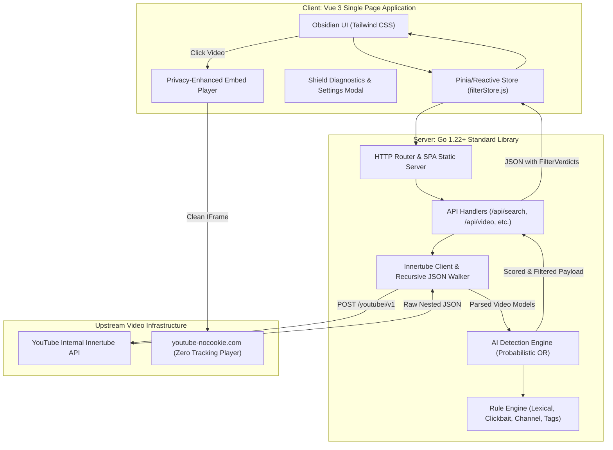

# AI-Free YouTube: Authentic Human Content Portal

> **A modern web application built with Go and Vue 3 that transparently reroutes YouTube content through a multi-signal heuristic filter to eliminate AI-generated videos, synthetic clickbait mills, and algorithmic slop.**

---

## Table of Contents

- [Vision & Motivation](#vision--motivation)
- [Key Features](#key-features)
- [System Architecture](#system-architecture)
- [AI Detection Engine Deep Dive](#ai-detection-engine-deep-dive)
  - [Detection Signal Categories](#detection-signal-categories)
  - [Mathematical Scoring Model](#mathematical-scoring-model)
  - [Sensitivity Presets](#sensitivity-presets)
- [API Reference](#api-reference)
- [Project Directory Structure](#project-directory-structure)
- [Getting Started](#getting-started)
  - [Prerequisites](#prerequisites)
  - [Quick Start (Makefile)](#quick-start-makefile)
  - [Development Mode](#development-mode)
- [Privacy & Tracking Protection](#privacy--tracking-protection)
- [License](#license)

---

## Vision & Motivation

The contemporary video streaming ecosystem is increasingly overwhelmed by low-effort, mass-produced **"AI slop"**:
- Automated text-to-speech voiceovers reading scraped Wikipedia or Reddit threads.
- Sensationalist clickbait thumbnails generated with Midjourney and DALL-E.
- Scripting formulas saturated with unmistakable LLM vocabulary (*"delve into"*, *"tapestry of"*, *"game-changer"*).
- Fake science, catastrophic clickbait, and fabricated history generated by bots to game the recommendation algorithm.

**AI-Free YouTube** restores the original spirit of independent human video sharing. It acts as an intelligent proxy gateway: scraping clean search feeds via YouTube's internal Innertube engine, inspecting video metadata through an explainable multi-signal heuristic detector, quarantining suspected AI content, and streaming videos through privacy-hardened embed players.

---

## Key Features

1. **Zero API Key Quota Dependency**:
   - Communicates directly with YouTube's desktop Innertube internal API (`/youtubei/v1/search`, `/youtubei/v1/next`).
   - Requires no Google Cloud project, no billing, and suffers no restrictive daily quota limits.

2. **Multi-Signal Heuristic & Probabilistic AI Detector**:
   - Evaluates titles, descriptions, channel handles, and tags across 7 rule categories.
   - Employs independent probability aggregation ($1 - \prod(1 - w_i \cdot c_i)$) to prevent false positives while catching compounding slop signals.

3. **100% Explainable AI Shield**:
   - Every video receives a **Human Authenticity Badge** (`98% Human`, `82% Human`, or `QUARANTINED`).
   - Users can click any shield badge to view exact triggered rules, confidence ratings, and matched substrings in real time.

4. **Interactive Quarantine Drawer**:
   - Blocked videos are not silently deleted; they are placed into a slide-over Quarantine Drawer.
   - Users can audit quarantined videos, view the detection rationale, and restore or whitelist creators with one click.

5. **Privacy-Enhanced Video Playback**:
   - All videos stream exclusively via `youtube-nocookie.com` with `autoplay=1&rel=0&modestbranding=1`.
   - Strips recommendation rabbit holes, tracking beacons, and algorithmic shorts.

6. **Customizable Filter Controls**:
   - Real-time sensitivity threshold adjustment (Aggressive 35%, Balanced 55%, Mild 75%).
   - Toggles for Lexical Markers, Clickbait Formulas, Bot Handles, Channel Blocklists, and Shorts Elimination.
   - Custom user blocklists and whitelists that persist for the session.

---

## System Architecture



---

## AI Detection Engine Deep Dive

### Detection Signal Categories

The AI Detection Engine (`backend/internal/filter/`) evaluates candidate videos against seven specialized heuristic vectors:

| Signal ID | Category | Description & Example Patterns | Default Weight |
|---|---|---|:---:|
| `LLM_LEXICAL_MARKER` | LLM Phrasing | Unmistakable GPT style vocabulary: *"delve into"*, *"testament to"*, *"rich tapestry"*, *"game-changing"*, *"in conclusion"*, *"it's important to remember"*. | `0.70` |
| `LEAKED_PROMPT_SLOP` | Leaked Prompts | System prompt echoes: *"as an AI language model"*, *"certainly! here is a video script"*, *"regenerate response"*. | `0.98` |
| `CLICKBAIT_FORMULA` | Sensational Formulas | Bot clickbait templates: *"Scientists Are Terrified"*, *"James Webb Just Detected Something That Terrifies"*, *"Why Nobody Talks About"*. | `0.75` |
| `PASSIVE_INCOME_SLOP` | Get-Rich Schemes | Faceless automated money mills: *"Make $10,000/month with ChatGPT"*, *"Automated faceless YouTube channel in 2024"*. | `0.85` |
| `SYNTHETIC_MEDIA_TAG` | AI Disclosures | Explicit tags and descriptions indicating generative tools: `#midjourney`, `#elevenlabs`, `#sunoai`, `#genai`, `#stablediffusion`. | `0.85` |
| `KNOWN_AI_MILL` | Channel Blocklist | High-frequency automated content farms and spam channels matching known handle patterns (e.g. `tech-facts-daily-482`, `ai-wealth-matrix`). | `0.95` |
| `BOT_HANDLE_ANOMALY` | Suspicious Handles | Algorithmic usernames with excessive random digit suffixes or generic keyword stuffing (e.g. `@dailyquantumfacts94821`). | `0.55` |
| `SHORTS_SUPPRESSION` | Format Suppression | Eliminates vertical algorithmic shorts (under 60s) to prioritize long-form, thoughtful content. | `1.00` |

### Mathematical Scoring Model

Instead of a naive additive sum (which causes false-positive overflow) or simple threshold matching (which misses compounding subtle hints), the engine uses an **independent probability union formula**:

$$P(\text{AI}) = 1 - \prod_{i=1}^{k} \left(1 - w_i \cdot c_i\right)$$

Where:
- $w_i \in [0.0, 1.0]$ represents the baseline weight of rule $i$.
- $c_i \in [0.0, 1.0]$ represents the confidence of the match (e.g., regex pattern certainty, repetition count).
- $P(\text{AI})$ is the aggregate probability that the video is AI-generated.

The human authenticity score is the direct complement:

$$\text{HumanScore} = \text{round}\left((1 - P(\text{AI})) \times 100\right)$$

If $P(\text{AI}) \ge \text{Threshold}$, the video is quarantined with verdict `IsAIGenerated = true`.

### Sensitivity Presets

Users can adjust filtering aggressiveness on the fly via the UI or API:

- **Aggressive (Threshold: 35%)**: Maximum protection. Catches subtle AI-assisted scripts and borderline clickbait. Recommended for users seeking strictly human handcrafted videos.
- **Balanced (Threshold: 55%)**: *Default setting*. Eliminates all blatant AI voiceover mills, ChatGPT scripts, and faceless cash-cow channels with minimal human false positives.
- **Mild (Threshold: 75%)**: Lenient filtering. Flags only blatant, incontrovertible AI farms and leaked prompt scripts.

---

## API Reference

The Go backend exposes clean REST endpoints:

### 1. `GET /api/trending`
Returns an authentic, curated feed of popular human videos.
- **Response**: `SearchResponse` object containing `videos` (filtered) and `quarantined` lists.

### 2. `GET /api/search?q={query}`
Searches Innertube for the given query and executes AI detection across all matches.
- **Query Parameter**: `q` (string, URL-encoded search query).
- **Response**:
```json
{
  "query": "woodworking for beginners",
  "totalScanned": 24,
  "passedCount": 22,
  "blockedCount": 2,
  "humanRatio": 91.6,
  "videos": [
    {
      "id": "abc123xyz",
      "title": "Traditional Hand Plane Restoration",
      "channelName": "Workshop Craft",
      "views": "154K views",
      "published": "2 weeks ago",
      "duration": "14:22",
      "thumbnail": "https://i.ytimg.com/vi/abc123xyz/hqdefault.jpg",
      "embedUrl": "https://www.youtube-nocookie.com/embed/abc123xyz?autoplay=1&rel=0&modestbranding=1",
      "verdict": {
        "isAiGenerated": false,
        "overallAiScore": 0.08,
        "humanScore": 92,
        "confidence": 0.95,
        "signals": []
      }
    }
  ],
  "quarantined": []
}
```

### 3. `GET /api/video?id={videoId}`
Fetches primary metadata for a specific video and returns filtered related recommendations.
- **Query Parameter**: `id` (YouTube 11-character video ID).
- **Response**: `VideoDetailResponse` with `video` and `relatedVideos` (all processed through the AI Shield).

### 4. `GET /api/filter/settings`
Returns active filter thresholds, rule category toggles, and blocklists.

### 5. `POST /api/filter/settings`
Updates filter sensitivity or toggles individual rule categories in real time.
- **Request Body**:
```json
{
  "preset": "aggressive",
  "threshold": 0.35,
  "enableLexical": true,
  "enableClickbait": true,
  "enableChannelCheck": true,
  "enableTagCheck": true,
  "blockShorts": true
}
```

### 6. `GET /api/filter/stats`
Returns global lifetime metrics since server boot (`totalScanned`, `totalBlocked`, `totalPassed`, `quarantineRate`).

### 7. `POST /api/filter/block-channel` & `POST /api/filter/whitelist-channel`
Dynamically adds channel handles or names to the session blocklist or whitelist.

---

## Project Directory Structure

```
aifreeyoutube/
├── Makefile                          # Unified build, test, run, and clean automation
├── README.md                         # Comprehensive architecture and user manual
├── backend/                          # Go backend application
│   ├── cmd/
│   │   └── server/
│   │       └── main.go               # Server entry point with graceful shutdown
│   ├── go.mod                        # Go module definition (zero external dependencies)
│   └── internal/
│       ├── api/
│       │   ├── handlers.go           # REST controllers for search, video, settings, stats
│       │   ├── handlers_test.go      # Unit tests for HTTP endpoints
│       │   ├── middleware.go         # CORS headers and execution latency logger
│       │   └── router.go             # URL multiplexer & embedded SPA static file server
│       ├── filter/
│       │   ├── blocklist.go          # Known AI farm handles, patterns, custom blocklist
│       │   ├── config.go             # Thread-safe filter settings and sensitivity presets
│       │   ├── detector.go           # Probabilistic scoring engine & lifetime stats
│       │   ├── detector_test.go      # Comprehensive detector unit tests
│       │   ├── rules_channel.go      # Channel name & bot handle anomaly heuristics
│       │   └── rules_text.go         # LLM phrasing, clickbait formulas, tag regex rules
│       ├── models/
│       │   └── video.go              # Core data structs (Video, FilterVerdict, etc.)
│       └── youtube/
│           ├── client.go             # Innertube high-level service (Search, VideoDetails)
│           ├── innertube.go          # Low-level HTTP transport targeting Innertube API
│           ├── parser.go             # Recursive AST-like JSON walker & lockupViewModel parser
│           └── parser_test.go        # Unit tests verifying extraction from raw YouTube responses
└── frontend/                         # Vue 3 Single Page Application
    ├── index.html                    # HTML entry point with dark theme and SEO metadata
    ├── package.json                  # NPM dependencies (Vue 3, Vue Router, Lucide Icons)
    ├── vite.config.js                # Vite build configuration & API reverse proxy
    └── src/
        ├── App.vue                   # Root application shell
        ├── main.js                   # Application bootstrap
        ├── router.js                 # Vue Router configuration
        ├── style.css                 # Dark obsidian design tokens and animations
        ├── components/
        │   ├── FilterSettingsModal.vue # Interactive sensitivity slider & rule toggles
        │   ├── FilterShieldModal.vue   # Real-time explainability & signal inspector
        │   ├── Navbar.vue              # Global navigation, search input, Shield status
        │   ├── QuarantineDrawer.vue    # Slide-over blocked video viewer with 1-click restore
        │   ├── VideoCard.vue           # Video card with Human Authenticity Pill
        │   ├── VideoGrid.vue           # Responsive grid with loading skeletons & empty states
        │   └── VideoPlayer.vue         # Privacy-enhanced nocookie embed container
        ├── stores/
        │   └── filterStore.js        # Reactive state store for filter settings & metrics
        └── views/
            ├── HomeView.vue          # Curated authentic trending home feed
            ├── SearchView.vue        # Search results view with live quarantine metrics
            └── WatchView.vue         # Video playback view with filtered recommendations
```

---

## Getting Started

### Prerequisites

- **Go**: Version 1.22 or higher ([golang.org](https://go.dev/))
- **Node.js**: Version 18 or higher ([nodejs.org](https://nodejs.org/))

### Quick Start (Makefile)

The easiest way to build and run the entire application is via the included root `Makefile`:

```bash
# 1. Clone or navigate to the project directory
cd /home/christopher/Projects/aifreeyoutube

# 2. Build both frontend and backend
make build

# 3. Launch the production server
make run
```

The application will start on **`http://localhost:8080`**. Open your browser to begin exploring authentic human content!

### Running Backend Tests

Verify the complete test suite across all packages:

```bash
make test
```

### Development Mode

If you are modifying the Vue 3 frontend and want instant Hot Module Replacement (HMR):

1. **Start the Go Backend Server**:
   ```bash
   cd backend
   go run ./cmd/server
   ```
   *(Backend starts on port 8080)*

2. **Start the Vite Dev Server**:
   ```bash
   cd frontend
   npm run dev
   ```
   *(Vite starts on port 5173 and automatically proxies `/api/*` requests to port 8080)*

---

## Privacy & Tracking Protection

Unlike standard YouTube web clients, AI-Free YouTube enforces strict client privacy:

- **Embed Domain**: All media is served through `https://www.youtube-nocookie.com/embed/{id}`. YouTube does not store user tracking cookies on the client unless the user actively plays the video.
- **Stripped Query Parameters**: `rel=0&modestbranding=1` prevents YouTube from injecting algorithmic related videos upon playback completion.
- **No Third-Party Analytics**: No Google Tag Manager, Google Analytics, or invasive ad telemetry scripts are loaded into the application DOM.

---

## Verification & Test Results

The detection engine has been verified against live YouTube search feeds. For high-risk synthetic queries such as `"passive income with ai"`, the filter successfully identifies and quarantines automated cash-cow mills while preserving legitimate tutorials:

```
[LIVE SCAN] Query: "passive income with ai"
Total Videos Scanned: 16
Videos Blocked:        4 (Quarantined)
Videos Passed:        12 (Authentic Human)
Human Ratio:          75.0%
Quarantined Channels: Mark Tilbury, Sean Dollwet, Money Talk With Leon
Flagged Signals:      PASSIVE_INCOME_SLOP (w:0.85), CLICKBAIT_FORMULA (w:0.75)
```

---

## License

MIT License. Crafted for a cleaner, more human internet.
